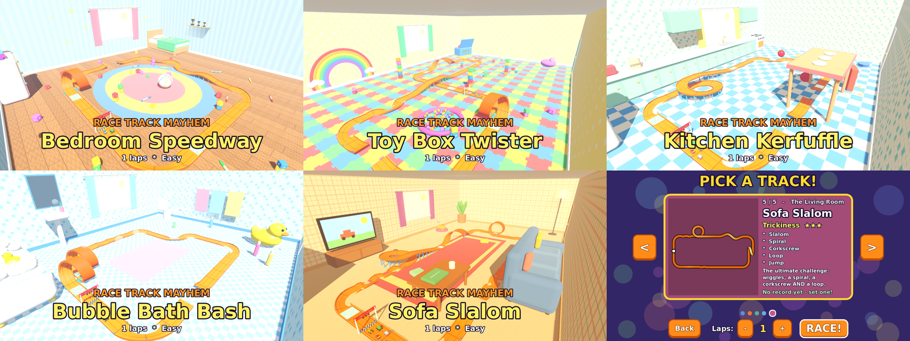

# 🏎️ Race Track Mayhem

A toy-car racing game for kids, made with **Godot 4**.


Pick a toy car and a track, then race four computer cars around an orange plastic toy track on a
kid's bedroom floor. Each race starts with the camera looking at the whole bedroom, then it swoops
down to your car for **3… 2… 1… GO!**

**5 tracks, each in its own room**

| Track | Room | Trickiness | Highlights |
|---|---|---|---|
| Bedroom Speedway | Bedroom: bed, teddy bear, rainbow rug | ★☆☆ | loop-de-loop, ramp jump, hill, chicane |
| Toy Box Twister | Playroom: foam mat, rainbow, ball pit, toy chest | ★★☆ | figure-8 bridge over itself, corkscrew, loop |
| Kitchen Kerfuffle | Kitchen: checker tiles, fridge, table, giant fruit | ★★☆ | spiral climb, big drop, double jump, S-bends |
| Bubble Bath Bash | Bathroom: bubbly tub, GIANT rubber duck | ★★☆ | double loop, wavy bumps, zig-zags, jump |
| Sofa Slalom | Living room at sunset: sofa, TV, sleeping cat | ★★★ | slalom, spiral, corkscrew, loop, jump |




## Download

- **SauceStore:** install *Race Track Mayhem* from the store with one click.
- **Directly:** download `RaceTrackMayhem-windows.zip` from the [latest release](https://github.com/uberwulf-hub/Race-Track-Mayhem/releases/latest),
  unzip it and run `RaceTrackMayhem.exe`.

### Publishing a new version
Bump the version and push a tag. GitHub Actions builds the Windows zip and publishes the release
(see `.github/workflows/release.yml`), and SauceStore shows the update within about 10 minutes.
```
git tag v1.0.1
git push origin v1.0.1
```
The store listing comes from `saucestore.json` (name, description, icon, credits).

## How to play it on your computer (from the source code)

1. Install **Godot 4.3 or newer** (the standard version, not .NET) from <https://godotengine.org/download>.
2. Get the code:
   ```
   git clone https://github.com/uberwulf-hub/Race-Track-Mayhem.git
   ```
3. Open Godot, click **Import**, choose the `project.godot` file in that folder, then press **F5** (▶ Play).

There are no art or sound files. The cars, track, bedroom and sound effects are all built in code.

## Controls

| Action | Keyboard | Gamepad |
|---|---|---|
| Go | W / ↑ | A or right trigger |
| Steer | A D / ← → | Left stick / D-pad |
| Brake / reverse | S / ↓ | X or left trigger |
| **Turbo** (blue bar) | Space / Shift | B or right bumper |
| Back on track | R | Y |
| Change camera | C | Left bumper |
| Pause | Esc / P | Start |

Tips:
- Drive over the glowing striped pads for a **BOOST**.
- **Steer into the turns.** Corners push you outward, and if you slam the outside rail too fast you fly off the track.
- **Hit the jumps fast** and line up your landing. Too slow and you drop into the gap; land beside the track and over the edge you go.
- Keep your speed up in the loops. Too slow upside down and you fall off. **MAYHEM!**

Whenever you come off the track, the screen fades and you're put back where you came off, with "Get Back to the Race!".

## What's in the game

- **Main menu** with a live race in the background, plus Options (laps, difficulty, volume) and How to Play
- **Garage**: five toy cars on a spinning turntable, each with Top Speed / Acceleration / Handling / Weight stats
  - Red Rocket · Blue Bolt · Monster Max · Sunny Buggy · Bubblegum Van
- **Track select**: mini-map of each track (brighter = higher), features, best time, lap count
- **Race**: intro zoom, start lights with a "3, 2, 1, GO!" voice countdown, laps, places, timer,
  speedometer, turbo meter, mini-map, pause menu, camera shake, speed lines, sparks on the walls
- Computer drivers that keep the race close (Easy / Normal / Hard)
- Real bump physics: cars shove and spin each other depending on where they're hit (heavy cars push light ones
  around, and a knock in a turn can send someone flying off)
- Results screen, with best times saved between plays
- Sound effects and chiptune music (all CC0, see [assets/audio/CREDITS.md](assets/audio/CREDITS.md)), with separate
  Music and Sound volume sliders:
  - a "Ready… Set… GO!" voice countdown and soft start beeps
  - a two-layer engine that revs with speed, brake squeals, and 3D engine sounds on the other cars
    (you hear them come up behind you and zoom past)
  - different music for the menu, the garage, races and results
- **Use your own sounds:** drop files into `assets/audio/local/` (see [its README](assets/audio/local/README.md)).
  They replace the built-in sounds on your computer only, and that folder is never uploaded to GitHub.
  That makes it the place for Pixabay sounds, whose license doesn't allow sharing the raw files.

## Code map (for tinkering)

| File | What it does |
|---|---|
| `scripts/track.gd` | Builds the tracks. **Each track is a `_layout_...()` function**, a list of pieces like `_straight(10)`, `_turn(90, 15, 20)`, `_loop(8.5, 10)`, `_corkscrew(62, 5.5)`, `_helix(360, 13, 7.5)`, `_slalom(5, 34, 13)`, `_waves(3)`, `_bridge()` and `_jump()`. The circuit closes itself automatically. Add an entry to `TRACKS` (with its `room`) and a layout function to make a new track. |
| `scripts/mesh_kit.gd` | Rounded "toy" box meshes and soft blob shadows. |
| `scripts/track_select.gd` | Track-picking screen. |
| `scripts/car_data.gd` | The cars, their colors and stats. Add a new car here. |
| `scripts/toy_car_model.gd` | Builds each car's 3D model from simple shapes. |
| `scripts/racer.gd` | Driving: speed, steering, boosts, jumps, falling off the loop, bumping, and the computer driver. |
| `scripts/race.gd` | Race flow: intro, countdown, camera, places, pause menu, results. |
| `scripts/race_hud.gd` | On-screen display and mini-map. |
| `scripts/rooms/room.gd` | Base class for the rooms: lighting, floor, walls, window, door and shape helpers. |
| `scripts/rooms/*_room.gd` | One file per room theme (bedroom, playroom, kitchen, bathroom, living room). Each one sets its colours and builds its furniture. |
| `scripts/main_menu.gd`, `scripts/vehicle_select.gd` | Menu screens. |
| `scripts/game_state.gd`, `scripts/sfx.gd` | Settings and saving, controls, UI theme, sound effects and music. |

Ideas for next time: an outdoor garden track, unlockable cars,
a split-screen two-player mode, and a ghost car of your best lap.
