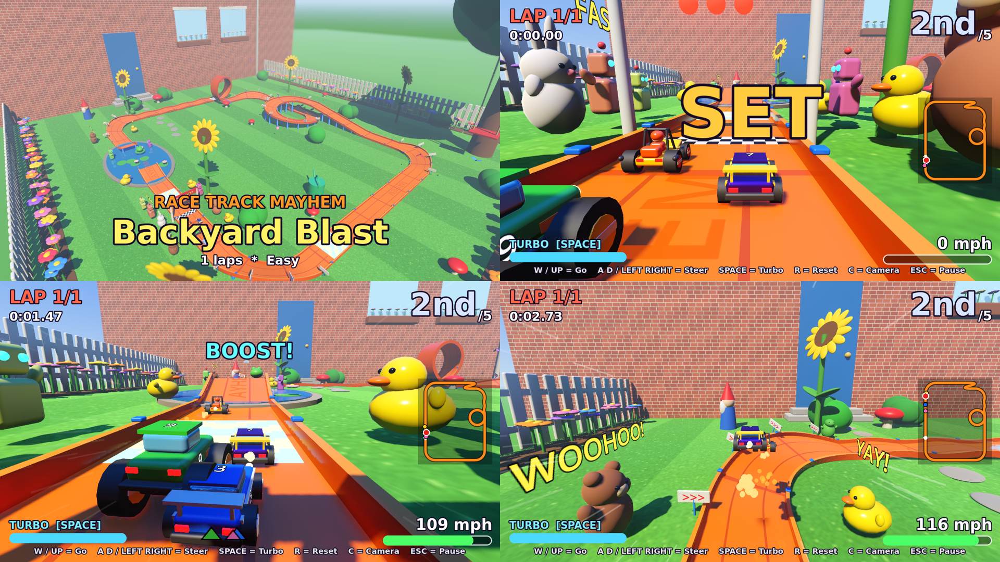
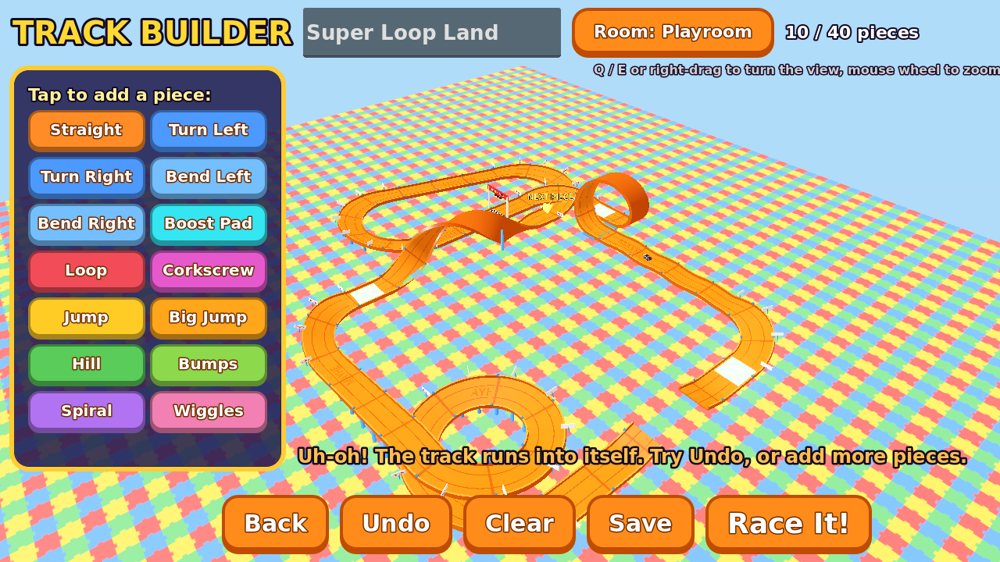
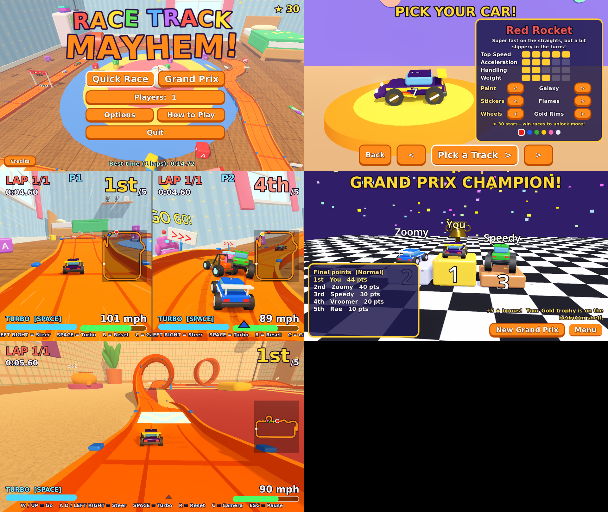

# 🏎️ Race Track Mayhem

A toy-car racing game for kids, made with **Godot 4**.


Pick a toy car and a track, then race four computer cars around an orange plastic toy track on a
kid's bedroom floor. Each race starts with the camera looking at the whole bedroom, then it swoops
down to your car for **3… 2… 1… GO!**

**7 tracks, each in its own room (and one outside!), plus a new Weekly Challenge track every Monday**

| Track | Room | Trickiness | Highlights |
|---|---|---|---|
| Bedroom Speedway | Bedroom: bed, teddy bear, rainbow rug | ★☆☆ | loop-de-loop, ramp jump, hill, chicane |
| Toy Box Twister | Playroom: foam mat, rainbow, ball pit, toy chest | ★★☆ | figure-8 bridge over itself, corkscrew, loop |
| Kitchen Kerfuffle | Kitchen: checker tiles, fridge, table, giant fruit | ★★☆ | spiral climb, big drop, double jump, S-bends |
| Bubble Bath Bash | Bathroom: bubbly tub, GIANT rubber duck | ★★☆ | double loop, wavy bumps, zig-zags, jump |
| Sofa Slalom | Living room at sunset: sofa, TV, sleeping cat | ★★★ | slalom, spiral, corkscrew, loop, jump |
| Backyard Blast | **Outdoors in the garden:** blue sky, picket fence, big tree with a swing, flowers, gnome, pond with a frog, butterflies | ★★☆ | giant jump over the pond, bumpy lawn, loop, spiral, slalom |
| Workshop Wheelie | Garage: pegboard of tools, workbench, red tool chest, tyre stacks, cones, a bike | ★★☆ | jump, hill, bumps, big jump over the toolbox, loop, slalom |

**Weekly Challenge** (main menu): a brand-new track every Monday, the same for everyone, with its own
online top 10 for the week.

**Cars:** Red Rocket, Blue Bolt, Monster Max, Sunny Buggy and Bubblegum Van, plus unlockable Rocket Rascal
(25 stars or a Grand Prix win), Fire Engine Fred (30 stars) and Ice Cream Dream (40 stars).









## Download

- **SauceStore:** install *Race Track Mayhem* from the store with one click.
- **Directly:** download `RaceTrackMayhem-windows.zip` from the [latest release](https://github.com/uberwulf-hub/Race-Track-Mayhem/releases/latest),
  unzip it and run `RaceTrackMayhem.exe`.

### Publishing a new version
Push a version tag, or on GitHub open **Actions → Release → Run workflow** and type the version.
GitHub Actions builds the Windows zip and publishes the release (see `.github/workflows/release.yml`),
and SauceStore shows the update within about 10 minutes.
```
git tag v1.0.1
git push origin v1.0.1
```
The store listing comes from `saucestore.json` (name, description, icon, credits).

## How to play it on your computer (from the source code)

1. Install **Godot 4.3 or newer** (the standard version, not .NET) from <https://godotengine.org/download>.
2. Get the code:
   ```
   git clone https://github.com/uberwulf-hub/Race-Track-Mayhem.git
   ```
3. Open Godot, click **Import**, choose the `project.godot` file in that folder, then press **F5** (▶ Play).

There are no art or sound files. The cars, track, bedroom and sound effects are all built in code.

## Controls

| Action | Keyboard | Gamepad | Touch screen |
|---|---|---|---|
| Go | W / ↑ | A or right trigger | GO |
| Steer | A D / ← → | Left stick / D-pad | < > |
| Brake / reverse | S / ↓ | X or left trigger | BRAKE |
| **Turbo** (blue bar) | Space / Shift | B or right bumper | TURBO |
| Use power-up | E / Q | Y | ITEM |
| Back on track | R | Back / View | R |
| Change camera | C | Left bumper | |
| Pause | Esc / P | Start | II |

To race each other, use **Race Online!**: every player on their own computer, phone or tablet.

Tips:
- Drive over the glowing striped pads for a **BOOST**.
- **Steer into the turns.** Corners push you outward. Slam the outside rail too fast and you BONK off it and slow right down (really fast = a spin-out), but you stay on the track.
  Little drivers can switch on **Steering help** in Options.
- **Hit the jumps fast** and line up your landing. Too slow and you drop into the gap; land beside the track and over the edge you go.
- Keep your speed up in the loops. Too slow upside down and you fall off. **MAYHEM!**

Whenever you come off the track, the screen fades and you're put back where you came off, with "Get Back to the Race!".

## What's in the game

**Power-ups.** Drive through the rainbow "?" boxes on the track, then press **E** (or **Y** on a controller) to use what you got:
- **Bubble Blaster:** shoots a soap bubble that drifts toward the car ahead. Cars it hits float along slowly in a bubble.
- **Bouncy Ball:** zig-zags off the rails and spins out cars it hits.
- **Water Balloon:** drops a slippery puddle behind you.
- **Rocket Boost:** a big burst of speed.
- **Bubble Shield:** blocks the next hit.

Cars further back get better power-ups, and the computer cars use them too. Switch them off in Options.
A blinking **INCOMING!** warning (with an arrow for the side) shows when a bubble or ball is about to hit you.

**Android (phones and tablets).** Each release also has `RaceTrackMayhem-android.apk`. Open the release page
on the phone, download the .apk and open it (allow "install unknown apps" when Android asks).
- Big on-screen buttons: steer < >, GO, BRAKE, TURBO, ITEM, pause and R (back on track). Steer with one thumb
  and hold GO with the other. Options > Touch buttons: Auto (on for phones/tablets), On or Off.
- Phones start on Low graphics, and the back button works like Back. Race Online works on phones too.
- Track Builder: tap the track to choose where to build, drag to turn the view, pinch or +/- to zoom.

**For little racers:** **Auto-Go** (Options, or when making a new player) drives forward by itself, so they
only steer. On phones, **Tilt to steer** turns the car by tipping the phone like a steering wheel.

**Cheers online:** six quick, kid-safe messages (Nice!, Wow!, Haha!, GG!, Go go go!, Oops!) in the lobby, on
the results, or with keys 1-6 in a race, where they pop up over your car. After a race, players can ask the host
for a **Rematch!**

**Race Online (home network).** Race other computers in your house:
- One computer taps **Race Online! > Host a Race**. The others tap **Race Online!** and the race shows up
  under "Races on your network" (or type the host's address, shown in the host's lobby).
- Up to 6 racers. Everyone picks their car; the host picks the track (including their own Track Builder
  tracks), laps, power-ups and whether computer cars join in.
- Each computer drives its own car and shares where it is about 20 times a second. Power-ups work online:
  shots appear on every screen, and hits count on the computer of the car that got hit.
- The first time you host, Windows may ask whether to let the game use the network: choose **Allow**
  (tick "Private networks").
- **Fix Firewall** (Windows, on the Race Online screen): if races don't show up or joining fails, tap it on BOTH
  computers and choose Yes on the Windows prompt. It removes any block rule (from clicking "Cancel" on the first
  network prompt) and lets the game through. Or just use Host on the Internet, which needs no firewall changes.
- If a race shows up but joining never works, the HOST computer's firewall is blocking it (usually because
  "Cancel" was clicked on the Windows prompt): Windows Security > Firewall & network protection > Allow an app
  through firewall > Change settings > tick Race Track Mayhem for Private. The game now says this after 10 seconds.

**Race over the internet (cousins in another house).** Tap **Race Online! > Host on the Internet** and the lobby
shows a 4-letter **race code**. The others tap **Race Online!**, type the code and **Join Internet Race**.
Everyone connects out to a small relay server (`server/relay`, runs free on Cloudflare), so no router or
firewall setup is needed. Everything else works like the home version.

**Players.** Up to 6 players each get their own save slot. The game asks "Who's racing?" when it starts:
pick your name, or make a new player (type a name, or use the on-screen letters with a controller) and choose
how tough the other cars are. Each player keeps their own stars, unlocks, trophies, best times, ghost laps,
tracks and settings (difficulty, laps, steering help). Switch players any time from the button at the top-left of the menu.

**Track Builder.** Build your own tracks from the main menu or the track picker. Your pieces show as a row of
numbered chips: tap a chip (or tap the piece on the track) to pick it, and it glows on the track. Then move it
left or right, or delete it. Undo brings back anything. There are two modes (switch with the Mode button):
Click the track (or a chip) where you want to build: new pieces go right after it, shown by the yellow
"NEW PIECES GO HERE" arrow and a "+" in the chip row. Tap Done to build on the end again.
- **Easy:** 8 big, simple pieces.
- **Advanced:** every piece; drag chips to reorder; Replace,
  Flip (left/right) and Copy; Redo; and shortcuts (`[` `]` pick, Ctrl+Left/Right move, F flip, D copy, Delete, Ctrl+Z/Y).

Your own tracks stand out in the track picker with a blueprint card and a "YOUR TRACK" ribbon.

**Online best times.** Every track has an online top 10 (one per number of laps). Finish a race and your
time is sent in: the results say if you made the list ("ONLINE RECORD!" for #1), and each track card shows the
current online record. Shared Track Builder tracks share one list, so friends race the same board. One spot per
racer name (your best). Switch it off in Options > Online times.

**Share tracks with a code.** On one of your tracks in the track picker, tap **Share**: you get a 5-letter code
(like `KXQRM`) to send to friends. They tap **Get a Track** (top-left of the track picker), type the code, and the
track is added to their own tracks, marked "Built by" whoever made it. Tracks are kept on the same Cloudflare
server as internet races (`server/relay/tracks.mjs`).

- **Pieces:** Straight, Turn Left/Right, Bend Left/Right, Boost Pad, Loop, Corkscrew, Jump, Big Jump, Hill, Bumps, Spiral and Wiggles.
- **Live preview:** a toy car drives your track while you build. A bouncing arrow shows where the next piece goes.
- **Always a working circuit:** the road back to the start line is drawn for you, so any combination of pieces makes a working track.
  If your pieces already come back around (like four left turns), they're joined up directly.
- **Kid-proof stunts:** loops, corkscrews and jumps come with their own boost pad, so cars are fast enough.
  A warning shows if the track runs into itself.
- **Make it yours:** pick a room (or the garden), name your track, and save up to 12 tracks. Race them from the track picker,
  where you can also edit or delete them. Your best times and ghost car are kept for each one.

**Ways to play**
- **Quick Race:** pick a car and any of the 7 tracks.
- **Grand Prix:** race all 7 tracks in a row for points (10, 8, 6, 5, 4), then a trophy ceremony on the podium.
  Gold, silver and bronze trophies are kept on the shelf in the bedroom (one per difficulty).
- **Ghost car:** a see-through replay of your best clean lap on each track drives alongside you.

**Unlockables.** Finish races to earn stars (3 for 1st place, 2 for 2nd, 1 for finishing), plus bonus stars for Grand Prix trophies:
- **Paint:** Sky Blue, Lime Zest, Midnight, Shiny Gold, Chrome, Galaxy.
- **Stickers:** Racing Stripes, Flames, Stars, Lightning, Checkers.
- **Wheels:** Gold Rims, Fat Slicks, Glow Wheels.
- **The secret car, Rocket Rascal:** win any Grand Prix (or collect 25 stars).

**Looks.**
- Godot's full renderer: soft shadows, contact shadows, bounce lighting, sunbeams and reflections, with Low, Medium and High settings.
  Older PCs automatically fall back to a simpler renderer.
- Tilt-shift blur on the intro and results, so it looks like a photo of real toys.
- Toy spectators (bears, bunnies, robots, dinosaurs, ducks) cheer beside the track.
- The rooms have moving extras: swaying curtains, a swishing cat tail, cartoons on the TV, rising bubbles, a toy train and a steaming pot.
- Cars squash on landings, lean in turns, puff dust and leave skid marks.
  Headlights come on in the sunset living room.
- Chevron signs on sharp turns, MAYHEM logos molded into the track, and start lights on the arch.

**Racing.**
- Start lights with a "Ready… Set… GO!" voice countdown, laps, places, timer, speedometer, turbo meter and a mini-map.
- Pause menu, camera shake, speed lines, sparks on the walls and controller rumble.
- A "WRONG WAY!" warning, plus arrows when a car is right behind you.
- Computer drivers that keep the race close (Easy, Normal, Hard).
- Real bump physics: cars shove and spin each other depending on where they're hit.
- Results with best times, stars and new unlocks, and an announcer for the final lap, new records and unlocks.

**Sound.** CC0 sound effects plus our own Mesa Mayhem soundtrack (see [assets/audio/CREDITS.md](assets/audio/CREDITS.md)), with separate Music and Sound volume sliders:
- A two-layer engine that revs with speed, brake squeals, and 3D engine sounds with a Doppler effect on the other cars.
- The Mesa Mayhem theme on the menu and pickers, its own race song for each room and a victory fanfare.

**Use your own sounds:** drop files into `assets/audio/local/` (see [its README](assets/audio/local/README.md)).
They replace the built-in sounds on your computer only, and that folder is never uploaded to GitHub.

**Options:** laps, difficulty, graphics quality, fullscreen, steering help, ghost car, power-ups, and three volume sliders.

The version number is shown faintly in the bottom-right corner of the main menu.

## Code map (for tinkering)

| File | What it does |
|---|---|
| `scripts/track.gd` | Builds the tracks. **Each track is a `_layout_...()` function**, a list of pieces like `_straight(10)`, `_turn(90, 15, 20)`, `_loop(8.5, 10)`, `_corkscrew(62, 5.5)`, `_helix(360, 13, 7.5)`, `_slalom(5, 34, 13)`, `_waves(3)`, `_bridge()` and `_jump()`. The circuit closes itself automatically. Add an entry to `TRACKS` (with its `room`) and a layout function to make a new track. |
| `scripts/mesh_kit.gd` | Rounded "toy" box meshes and soft blob shadows. |
| `scripts/track_select.gd` | Track-picking screen. |
| `scripts/track_editor.gd` | The Track Builder. Pieces are defined in `Track.PIECES` and built in `Track._piece()`; the road home is a turn-straight-turn path (`Track.dubins()`). |
| `scripts/car_data.gd` | The cars, their colors and stats. Add a new car here. |
| `scripts/toy_car_model.gd` | Builds each car's 3D model from simple shapes. |
| `scripts/racer.gd` | Driving: speed, steering, boosts, jumps, falling off the loop, bumping, and the computer driver. |
| `scripts/race.gd` | Race flow for 1 or 2 players: intro, countdown, cameras, places, pause menu, results, Grand Prix points. |
| `scripts/car_audio.gd` | A player's engine and brake sounds. |
| `scripts/ghost_car.gd` | Records your best lap and replays it as a ghost. |
| `scripts/skid_marks.gd`, `scripts/spectators.gd` | Skid marks, and the toy crowd. |
| `scripts/powerups.gd` | Item boxes, the five power-ups, and how the computer cars use them. |
| `scripts/unlocks.gd` | Everything you can unlock and what it costs in stars. |
| `scripts/podium.gd`, `scripts/trophy.gd` | Grand Prix trophy ceremony and the trophy model. |
| `scripts/race_hud.gd` | On-screen display and mini-map. |
| `scripts/rooms/room.gd` | Base class for the rooms: lighting, floor, walls, window, door and shape helpers. |
| `scripts/rooms/*_room.gd` | One file per room theme (bedroom, playroom, kitchen, bathroom, living room, garden). Each one sets its colours and builds its furniture. Set `outdoor = true` for a sky instead of walls. |
| `scripts/main_menu.gd`, `scripts/vehicle_select.gd` | Main menu, and the garage (car picking and paint jobs). |
| `scripts/game_state.gd`, `scripts/sfx.gd` | Settings and saving, controls, UI theme, sound effects and music. |

Ideas for next time: online leaderboards, and an Android version.
